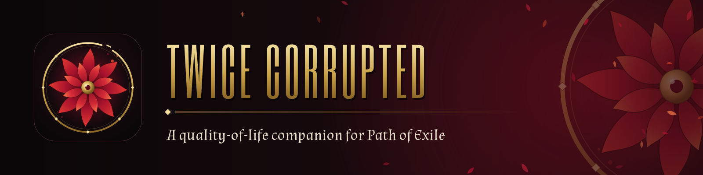
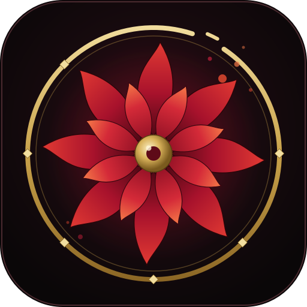

<p align="center">
  
</p>

<p align="center">
  
  
  
  
</p>

<p align="center">
  <a href="#features">Features</a> ·
  <a href="#install-and-run">Install</a> ·
  <a href="#configuration">Configuration</a> ·
  <a href="#documentation">Docs</a> ·
  <a href="docs/BRAND.md">Design</a>
</p>

# Twice Corrupted

A desktop quality-of-life companion for **Path of Exile**, built with Python and PySide6. It brings map-search trade links, inventory and map-stash slot highlighting, calibration and overlays together in one window, and is being developed into a fuller companion app. The roadmap is in [`docs/`](docs/).

**Repository:** <https://github.com/viexhd/Twice-Corrupted> (formerly `My-Poe-Project`; old links redirect).

> **This product isn't affiliated with or endorsed by Grinding Gear Games in any way.**

**Compliance.** Twice Corrupted follows GGG's published rules for third-party tools (<https://www.pathofexile.com/developer/docs>) by default. It never reads or changes game memory or game files, nothing sends game input on a timer, and no key press performs more than one game action. The earlier life-flask timer and F1/F2 "dump" macros were retired for breaking those rules.

**One exception is opt-in:** the Area Select tab's **experimental transfer** Ctrl-clicks every slot you select with one Alt+drag. That is many game actions per gesture, which GGG's rules don't allow. It is off by default, needs an explicit acknowledgement, and lives in its own package (`poe_qol/experimental/`). See [`docs/COMPLIANCE_REVIEW.md`](docs/COMPLIANCE_REVIEW.md) §7. GGG doesn't certify any third-party tool, so use any tool at your own discretion.

## Features

| Tab | What it does | Game input |
|---|---|---|
| **Macros** | Master on/off switch, per-macro toggles and hotkeys, **F12** emergency stop, **Pause** master toggle | None |
| **Inventory** | Clickable 12×5 grid, named slot profiles, a click-through **overlay** that highlights the chosen slots over the game, cursor-and-hotkey **calibration**. You click the highlighted slots yourself. | None |
| **Map Stash** | The same highlighter for a 12×6 map stash tab | None |
| **Area Select** | **Alt+drag** across the inventory to select slots, with a live rectangle, slot count and empty/occupied marks. **Manual** mode (default) keeps the slots highlighted and ticks each one off as you Ctrl-click it. **Experimental** mode Ctrl-clicks them for you. See [`docs/AREA_SELECT.md`](docs/AREA_SELECT.md). | Manual: none. Experimental: ⚠️ many clicks per gesture, **not compliant** |
| **Map Search** | Pick map mods to exclude, set rarity, corrupted, tier and a minimum "# Modifiers", and save your own presets. **Open Trade** opens the pre-filled search (`/trade/search/<league>?q=…`) in the Trade Browser; **Open in my browser** uses your normal browser instead. | None. By default no API call is made; the trade site runs the search when the page opens. |
| **Tools → Trade Browser** | A browser window showing the real pathofexile.com/trade. Log in there yourself (email or Steam sign-in). Only `pathofexile.com` pages load inside it, and other links open in your normal browser. **Sign out & clear** wipes its cookies. The app never reads them. | None |
| **Wealth** | **Divine per hour** from your Wealthy Exile CSV exports: it compares the two newest exports in a folder you pick and re-checks it every N minutes (minimum 5). Includes an optional **always-on-top overlay** over the game that you can drag and right-click. | None. Reads only your CSV files and never logs into Wealthy Exile. |
| **Flipper** | Ranks currencies to flip using poe.ninja prices | None |
| **Pricer** | Prices a copied item using the trade site | None. ⚠️ It calls the trade site's search API; see the compliance doc. |
| **Coordinate picker** | Ctrl+Alt+C saves the cursor position, Ctrl+Alt+V lists the saved positions | None |
| **Help → About** | Version and the GGG disclaimer | — |

**Divine-per-hour workflow:**
1. On wealthyexile.com press **Sync stash**.
2. Open **⋯ → Export CSV** and save the file into your exports folder.
3. Repeat later.

The overlay shows the change between your last two exports. Each export's Divine Orb row supplies the chaos-per-divine rate automatically, or you can set your own. The export time comes from the file name Wealthy Exile gives it (`Wealthy-Exile-export-MM_DD_YYYY H_MM.csv`). It needs PoE in windowed or windowed-fullscreen mode. A live Wealthy Exile feed isn't built: Wealthy Exile has no public API, so that would need their permission (see [`docs/WEALTHY_EXILE_INTEGRATION.md`](docs/WEALTHY_EXILE_INTEGRATION.md)).

**Under the hood**

- **Plugin-style macros.** One file in `src/poe_qol/macros/`: subclass `Macro` and add `@register`.
- **Layered YAML config.** `config/default.yaml`, then a profile (`config/profiles/*.yaml`), then your personal overrides (`config/user.yaml`, written by the UI and ignored by git).
- **Window-relative calibration**, so the overlay follows the game window.

## Requirements

- Windows 10/11
- Python **3.11+** (tested on 3.12 and 3.14)
- PoE in **windowed** or **windowed fullscreen** mode, for the overlay

## Install and run

### Get the code

```powershell
git clone https://github.com/viexhd/Twice-Corrupted.git
cd Twice-Corrupted
```

If you cloned the repo under its old name, point the existing clone at the new URL:

```powershell
git remote set-url origin https://github.com/viexhd/Twice-Corrupted.git
```

### Quick start

Double-click **`poe_qol/run.bat`**. On first launch it creates `poe_qol/.venv`, installs the dependencies and the app, then starts it.

PoE usually runs elevated, and Windows blocks global hotkeys from non-elevated programs. If hotkeys (F12, Ctrl+Alt+C, the calibration key) do nothing while the game has focus, use **`poe_qol/run-admin.bat`**.

### Manual setup

```powershell
cd poe_qol
py -m venv .venv
.venv\Scripts\activate
pip install -r requirements.txt
pip install -e .
python -m poe_qol                 # or: twice-corrupted
```

| Command | Installs |
|---|---|
| `pip install -e .` | Runtime: PySide6, PyYAML, keyboard, pydirectinput-rgx |
| `pip install -e .[vision]` | Adds numpy, opencv-python and mss. Area Select uses numpy + mss for empty-slot detection and works without them. |
| `pip install -r requirements-lock.txt` then `pip install -e . --no-deps` | The exact verified versions |

> **Naming:** the product and distribution are called **Twice Corrupted** (`twice-corrupted`). The Python import package and the `poe_qol/` folder keep their original name for now, so existing installs and the unmerged design branch keep working.

## Configuration

| File | Purpose | Edit it? |
|---|---|---|
| `poe_qol/config/default.yaml` | Every setting with comments (hotkeys, grid geometry, trade league) | Yes, but prefer a profile or the UI |
| `poe_qol/config/profiles/<name>.yaml` | Partial overrides. `app.profile` in `default.yaml` picks one. | Yes |
| `poe_qol/config/user.yaml` | Written by the UI: calibration, slot selections, Map Search state. **Not tracked by git.** | Usually not |
| `poe_qol/config/map_mods.yaml` | Map Search mod catalogue (trade stat ids, categories, presets) | Yes, when stat ids change between leagues |
| `poe_qol/config/slot_profiles*/` | Named slot selections saved from the UI | Via the UI |
| `poe_qol/logs/` | Rotating log file and captured coordinates. **Not tracked.** | No |

The inventory and map-stash grids still live under `macros.inventory_dump` and `macros.map_stash_dump` in config. The names are historical and kept so your existing calibration carries over.

Known limitation: start the app from the `poe_qol` folder (`run.bat` does this), because some config paths resolve against the working directory. A fix is planned in [`docs/TECHNICAL_AUDIT.md`](docs/TECHNICAL_AUDIT.md) §3.2.

## Development

```powershell
# run the tests (from the repo root)
poe_qol\.venv\Scripts\python -m unittest discover -s poe_qol/tests -v
```

- Architecture, the macro plugin guide and the Map Search data format are in [`poe_qol/README.md`](poe_qol/README.md).
- `tests/test_compliance.py` enforces the compliance decisions. Read [`docs/COMPLIANCE_REVIEW.md`](docs/COMPLIANCE_REVIEW.md) before adding a feature.

## Documentation

| Document | Contents |
|---|---|
| [`docs/RESEARCH_REPORT.md`](docs/RESEARCH_REPORT.md) | Survey of community tools, design lessons, feature ideas |
| [`docs/TECHNICAL_AUDIT.md`](docs/TECHNICAL_AUDIT.md) | Architecture review, bugs, technical debt, refactoring plan |
| [`docs/FEATURE_ROADMAP.md`](docs/FEATURE_ROADMAP.md) | Prioritised roadmap and final recommendations |
| [`docs/UI_UX_PROPOSAL.md`](docs/UI_UX_PROPOSAL.md) | Design system, navigation, layouts |
| [`docs/COMPLIANCE_REVIEW.md`](docs/COMPLIANCE_REVIEW.md) | GGG policy and per-feature risk assessment |
| [`docs/AREA_SELECT.md`](docs/AREA_SELECT.md) | Alt+drag area selection: setup, usage, settings, architecture, limitations |
| [`docs/WEALTHY_EXILE_INTEGRATION.md`](docs/WEALTHY_EXILE_INTEGRATION.md) | Wealthy Exile integration feasibility and proposal |
| [`docs/REPOSITORY_AUDIT.md`](docs/REPOSITORY_AUDIT.md) | What the cleanup changed and why |
| [`docs/VERIFICATION_REPORT.md`](docs/VERIFICATION_REPORT.md) | What was tested, known issues |
| [`docs/BRAND.md`](docs/BRAND.md) | Visual identity: palette, icon, banner, type |

## Repository layout

```
Twice-Corrupted/
docs/                     research, audit, roadmap and design documents
legacy/                   archived scripts and retired macros (reference only, not used)
poe_qol/
    assets/               app icon, banner, social preview (+ brand/icon.svg source)
    config/               default.yaml, profiles, slot profiles, map mod catalogue
    src/poe_qol/
        core/             config, shared state, logging
        engine/           Macro base class, registry, scheduler
        macros/           one file per macro (auto-discovered)
        input/            global hotkeys, input sending, low-level mouse hook
        area_select/      Alt+drag selection: grid mapping, gesture, overlay model, transfer
        experimental/     opt-in features that break GGG's rules (isolated)
        vision/           window lookup (+ optional capture / template matching)
        trade/            Map Search query builder and trade URL
        ui/               Qt main window and tab widgets
        economy/          poe.ninja flipper, Wealthy Exile CSV + divine/hour
        tools/            build_brand (renders the icon / banner assets)
    tests/                unittest suite
    pyproject.toml        package metadata and dependencies
    requirements*.txt     runtime install / exact lock
    run.bat, run-admin.bat
```

## Design

The visual identity, **"scarlet rot & gilt"**, uses warm obsidian surfaces, bone-white text, gilt-gold actions and crimson highlights. It centres on an original two-layer bloom of blade-curved petals inside a cracked gold ring: *twice corrupted*. Its mood is inspired by Malenia from *Elden Ring*. It is fan inspiration only, and no FromSoftware or Grinding Gear Games artwork, logos or likenesses are used. Details and rebuild steps are in [`docs/BRAND.md`](docs/BRAND.md).

<p align="center"></p>
