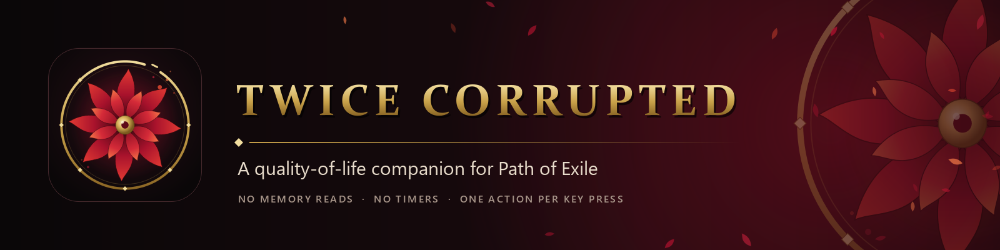

# Brand: "Scarlet Rot & Gilt"

<p align="center"></p>

## Idea

**Twice Corrupted** takes its mood from Malenia in *Elden Ring*: the scarlet rot that blooms when she's pushed, the gilt prosthetic, the poise of a blade dance. It ties that to Path of Exile's own idea of corruption, an item changed past the point of return.

The art is **original**. It contains no FromSoftware or Grinding Gear Games artwork, logos, characters, names or likenesses, and it shouldn't be described as official merchandise of either. It is fan inspiration, credited as such in the README.

| Motif | Shown as | Why |
|---|---|---|
| Scarlet rot bloom | Two rings of 8 crimson petals, offset by 22.5° | "Twice": the corruption happens twice |
| Blade dance | Each petal is a curved, blade-like sweep, not a round leaf | Elegance and danger at once |
| Gilt prosthetic | A gold ring with gold diamonds | Craft and restraint against the rot |
| Corruption | The ring is **cracked** near one o'clock, with a shard knocked loose | Something altered that can't be undone |
| Spores | Small ember dots drifting out of the ring | Motion and spread, used sparingly |

## Palette

The same values are used in `ui/styles.py` (app theme) and `tools/build_brand.py` (art).

| Token | Hex | Use |
|---|---|---|
| `BG_0` obsidian | `#0D0A0B` | App background |
| `BG_1` | `#141012` | Pages and tabs |
| `BG_2` | `#1C1518` | Cards and inputs |
| `BG_3` | `#261C20` | Hover |
| `LINE` / `LINE_STRONG` | `#33262A` / `#4A363C` | Hairlines and focus borders |
| `FG_0` bone | `#EFE6DA` | Primary text |
| `FG_1` ash | `#BEB0A4` | Secondary text |
| `FG_2` | `#85776E` | Captions |
| `ACCENT` gilt | `#D9B25A` | Primary buttons, focus, selection (dark text on it) |
| `ACCENT_HI` | `#F2DE9F` | Gilt hover and highlights |
| `ROT` | `#B3122E` | Brand crimson |
| `ROT_HI` ember | `#E0482F` | Selected-tab underline, rot highlights |
| `DANGER` | `#E5484D` | Errors and stop. Kept brighter than `ROT` so danger never reads as decoration. |

Accessibility is checked in `tests/test_brand.py`:
- bone on `BG_1` is at least 7:1 (AAA)
- ash on `BG_1` is at least 4.5:1
- gilt on obsidian is at least 4.5:1, and dark text on gilt is at least 4.5:1
- ember is at least 3:1, so it's used for large text and UI only

## Type

| Role | Font |
|---|---|
| Display (banner title) | **Cinzel** if it's installed, otherwise Constantia, then Georgia. Rendered into the PNG, so readers don't need the font. |
| UI | Segoe UI Variable / Segoe UI (bundled with Windows) |
| Taglines | Segoe UI semibold, letter-spaced caps, ash colour |

## Assets

| File | Size | Notes |
|---|---|---|
| `poe_qol/assets/brand/icon.svg` | vector | **Source of truth.** Groups `tile` and `bloom` can be rendered separately. |
| `poe_qol/assets/app_icon.png` | 512² | Runtime window and taskbar icon |
| `poe_qol/assets/app_icon.ico` | 16–256 | Windows multi-size icon |
| `poe_qol/assets/app_icon_1024.png` | 1024² | Master |
| `poe_qol/assets/banner.png` | 1600×400 | README header |
| `poe_qol/assets/social_preview.png` | 1280×640 | Upload under GitHub → Settings → Social preview |

Rebuild after any change:

```powershell
cd poe_qol
.venv\Scripts\python -m poe_qol.tools.build_brand
```

## Usage rules

- Gilt is for the **one** primary action per view. Crimson marks state (the selected tab, brand moments) and is never the colour of a destructive button.
- The bloom never appears in-app as decoration behind data. It belongs to the icon, banner and About dialog.
- Don't recolour the icon. On light backgrounds keep the dark tile: it's part of the mark.
- Never pair the mark with GGG or FromSoftware logos, and never use the game's own UI art.
